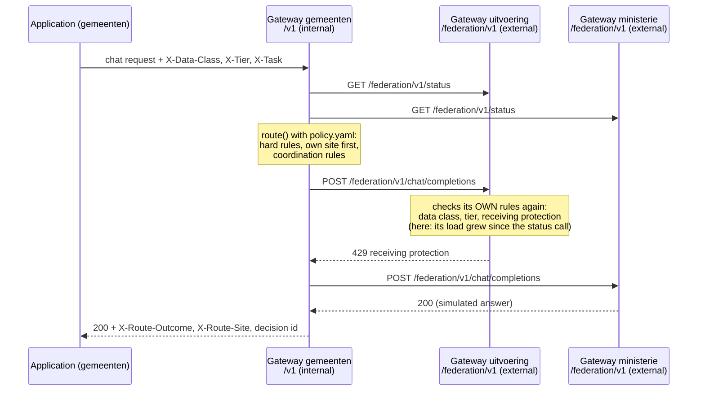

# Architecture: the federated gateway model

The brief asks for a federated gateway model (approach A): every network partner runs at least a **local gateway** for internal routing and, connected to it, a **gateway for external routing** to the other partners. Larger organisations often already have an internal AI gateway; teams can connect to it or design both gateways themselves. Whether there are external components (a central broker, a research facility, a commercial provider) is up to the team.

## The four roles

The brief names four parties. The starter models them as four fictitious organisations, one per role:

| Role in the brief | Fictitious organisation in `data/network.yaml` | Own site (fictitious) |
|---|---|---|
| Minbzk (ministry) | `ministerie` | `min-rc1`: 6 GPUs, small, medium and embedding models |
| Belastingdienst (executive agency) | `uitvoering` | `uvo-rc1`: 12 faster GPUs, all model sizes |
| Provincie Zuid-Holland (province) | `provincie` | `prov-dc1`: 4 GPUs, small, medium and embedding models |
| Municipalities through VNG | `gemeenten` | `gem-shared`: 2 GPUs, only small and embedding models |

Plus two sites outside the federation: `onderzoek-ai`, a shared research facility that only takes batch work at night, and `eu-cloud`, a commercial EU provider that only takes public and internal data. All numbers are invented; they are chosen so the scenarios produce contention.

## Request flow in the starter

What each part does in [`tooling/inferentienet/gateway.py`](../tooling/inferentienet/gateway.py):

| Part | Responsibility |
|---|---|
| Internal gateway, `POST /v1/chat/completions` | Accepts requests from the organisation's own applications (OpenAI-compatible). Refuses requests without a data class. Routes with the shared rules: own site first, then another member, then an external site. Keeps an explanation per decision at `GET /decisions/<id>`. |
| External gateway, `POST /federation/v1/chat/completions` | Accepts requests from other members for its own sites. Checks its own acceptance rules again (data class, tier, receiving protection) and may refuse. This is where the decentralised responsibility of the provider sits. |
| Status, `GET /federation/v1/status` | Publishes the load of its own sites, so the other gateways can see where capacity is free. Comparable to a congestion map for the electricity grid. |
| Router, [`router.py`](../tooling/inferentienet/router.py) | The decision rules, read from `data/policy.yaml` and `data/network.yaml`. Deterministic, no LLM, every decision explained step by step. |

## Central, federated or hybrid

The brief asks teams to show how coordination is arranged. Three basic shapes:

| Shape | How it works | Points to discuss |
|---|---|---|
| **Central broker** | One gateway (or broker) sees all capacity and places every request. | Single point of failure and of control. Who runs it, under which agreement? Simplest to make fair. |
| **Federated** (the starter) | Every organisation runs the same rules in its own gateway, publishes its load and decides for itself what it accepts. | No single owner; needs agreement on shared rules and on what is published. Stale status can cause refusals, hence retries. |
| **Hybrid** | Local routing stays federated; a shared broker only handles scarce situations, settlement, or the market. | Often the most realistic: autonomy in normal times, coordination under scarcity. |

## What the starter does not do

- No real models run anywhere. Answers are labelled `[gesimuleerd]`.
- No authentication between gateways. A real federation needs mutual TLS, signed requests or a trust framework; that is part of the design question.
- Load is simulated per gateway: research and commercial sites are simulated separately by every gateway.
- No streaming, no tool calls, no embeddings endpoint: only `/v1/chat/completions`.

These are deliberate simplifications to keep the starter readable. Replace them as far as your design needs.
